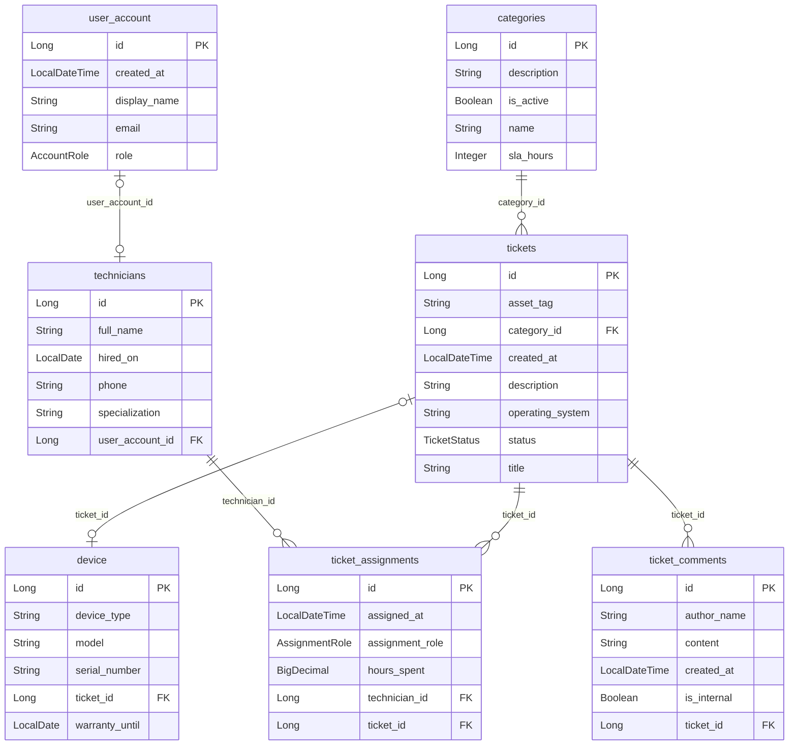

# Schemat bazy danych

Plik generują reguły projektu (panel Maven → Lifecycle → verify). Nie edytujcie go ręcznie.

Tabele: 7 · kolumny: 42 · relacje: 4 × @ManyToOne, 3 × @OneToMany, 2 × @OneToOne, 0 × @ManyToMany

| Tabela | Encja | Kolumny | Klucze obce |
|---|---|---|---|
| categories | Category | 5 | — |
| device | Device | 6 | ticket_id |
| technicians | Technician | 6 | user_account_id |
| ticket_assignments | TicketAssignment | 6 | technician_id, ticket_id |
| ticket_comments | TicketComment | 6 | ticket_id |
| tickets | Ticket | 8 | category_id |
| user_account | UserAccount | 5 | — |

